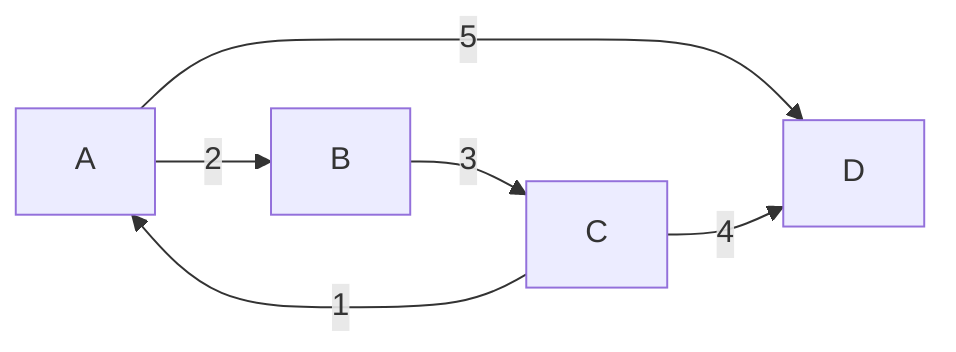
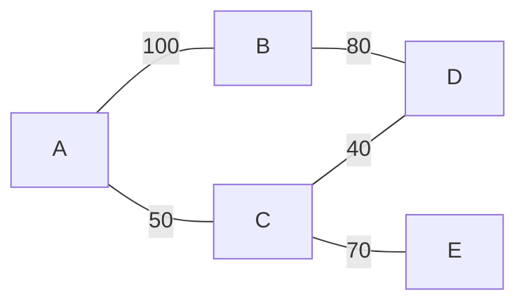

# AEDS 06 (Grafos) e AEDS 07 (Complexidade) – Resolução

---

# PARTE 1 – Grafos

## Exercício 1 – Matriz de adjacência (grafo orientado)

Arestas: A->B (3), A->C (5), B->D (2), C->D (4), D->E (1).

|   | A | B | C | D | E |
|---|---|---|---|---|---|
| **A** | 0 | 3 | 5 | 0 | 0 |
| **B** | 0 | 0 | 0 | 2 | 0 |
| **C** | 0 | 0 | 0 | 4 | 0 |
| **D** | 0 | 0 | 0 | 0 | 1 |
| **E** | 0 | 0 | 0 | 0 | 0 |

## Exercício 2 – Representação gráfica

```
M = 0 2 0 5
    0 0 3 0
    1 0 0 4
    0 0 0 0
```

- Linha A: A->B (peso 2), A->D (peso 5)
- Linha B: B->C (peso 3)
- Linha C: C->A (peso 1), C->D (peso 4)
- Linha D: nenhuma saída

**Vértices:** A, B, C, D  
**Direção:** indicada pelas setas abaixo  
**Pesos:** os números nas setas



---

## Exercício 3 – Grafo não orientado (rede de computadores)

| Origem | Destino | Velocidade |
|---|---|---|
| A | B | 100 |
| A | C | 50 |
| B | D | 80 |
| C | D | 40 |
| C | E | 70 |

### 1) Representação gráfica



### 2) Matriz de adjacência

|   | A | B | C | D | E |
|---|---|---|---|---|---|
| **A** | 0 | 100 | 50 | 0 | 0 |
| **B** | 100 | 0 | 0 | 80 | 0 |
| **C** | 50 | 0 | 0 | 40 | 70 |
| **D** | 0 | 80 | 40 | 0 | 0 |
| **E** | 0 | 0 | 70 | 0 | 0 |

---

## Exercício 4 – Análise de matriz

```
M = 0 1 1 0
    0 0 1 1
    0 0 0 1
    0 0 0 0
```

### 1) Quantos vértices?
A matriz é 4×4, então **4 vértices** (A, B, C, D).

### 2) Quantas arestas?
2 + 2 + 1 + 0 = **5 arestas**.

### 3) Grau de entrada e saída
- **Grau de saída** = soma da **linha**.
- **Grau de entrada** = soma da **coluna**.

| Vértice | Grau de saída | Grau de entrada |
|---|---|---|
| A | 2 | 0 |
| B | 2 | 1 |
| C | 1 | 2 |
| D | 0 | 2 |

### 4) Caminho entre A e D
Existem 3 caminhos:

- A -> B -> D (2 arestas)
- A -> C -> D (2 arestas)
- A -> B -> C -> D (3 arestas)

---

## Exercício 5 – Aplicações de grafos (escolhi **GPS**)

| Pergunta | Resposta |
|---|---|
| **1. O que é um vértice?** | Um ponto do mapa: cruzamento, esquina, endereço, ponto de interesse. |
| **2. O que é uma aresta?** | Um trecho de rua/estrada que liga dois pontos. Pode ser **orientada** (rua de mão única) ou não (mão dupla). |
| **3. Qual o peso da aresta?** | O "custo" de percorrer o trecho: **tempo estimado** (considerando trânsito e limite de velocidade), ou a distância em km, ou pedágio. |
| **4. Qual algoritmo?** | **Dijkstra** para achar o menor caminho (menor tempo/distância) da origem ao destino. Variante **A\*** (A estrela) é muito usada em GPS real, pois usa a distância em linha reta como "palpite" para chegar mais rápido. |

---