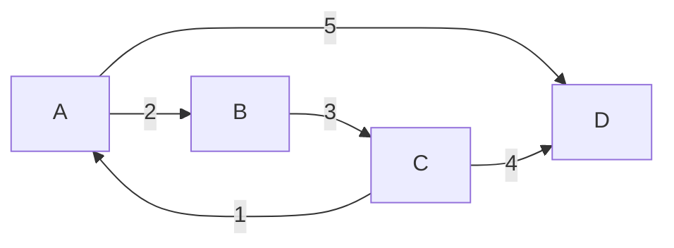
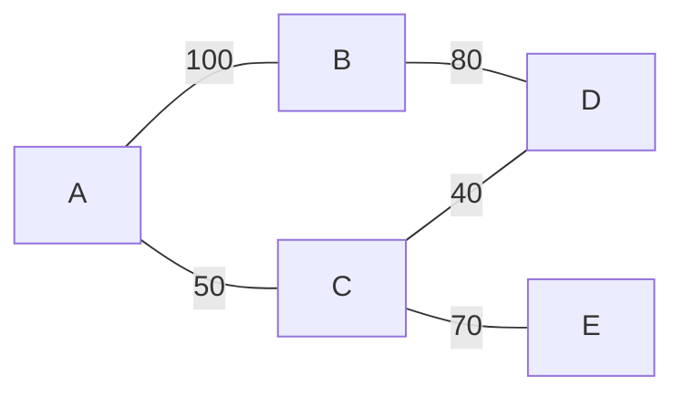

# AEDS 06 (Grafos) e AEDS 07 (Complexidade) – Resolução

---

# PARTE 1 – Grafos

> **Ideia geral (analogia):** um grafo é um mapa de cidades (**vértices**) ligadas por estradas (**arestas**).
> A **matriz de adjacência** é uma tabela onde a **linha** é a cidade de onde você sai e a **coluna** é a cidade aonde você chega.
> O número na célula é o "peso" da estrada (distância, velocidade etc.). **0 = não existe estrada.**

## Exercício 1 – Matriz de adjacência (grafo orientado)

Arestas: A→B (3), A→C (5), B→D (2), C→D (4), D→E (1).

**Como fiz:** montei uma tabela 5×5 (vértices A, B, C, D, E). Para cada aresta X→Y, escrevi o peso na linha X, coluna Y. O resto fica 0.

|   | A | B | C | D | E |
|---|---|---|---|---|---|
| **A** | 0 | 3 | 5 | 0 | 0 |
| **B** | 0 | 0 | 0 | 2 | 0 |
| **C** | 0 | 0 | 0 | 4 | 0 |
| **D** | 0 | 0 | 0 | 0 | 1 |
| **E** | 0 | 0 | 0 | 0 | 0 |

Em formato de matriz:

```
        0 3 5 0 0
        0 0 0 2 0
M   =   0 0 0 4 0
        0 0 0 0 1
        0 0 0 0 0
```

Como o grafo é **orientado** (ruas de mão única), a matriz **não é simétrica**. E não tem saída saindo de E (linha toda zero).

---

## Exercício 2 – Representação gráfica

```
M = 0 2 0 5
    0 0 3 0
    1 0 0 4
    0 0 0 0
```

**Como fiz:** 4 linhas/colunas = 4 vértices (A, B, C, D). Li cada linha e, para cada número diferente de zero, desenhei uma seta da linha para a coluna com o peso.

- Linha A: A→B (peso 2), A→D (peso 5)
- Linha B: B→C (peso 3)
- Linha C: C→A (peso 1), C→D (peso 4)
- Linha D: nenhuma saída

**Vértices:** A, B, C, D  
**Direção:** indicada pelas setas abaixo  
**Pesos:** os números nas setas



Desenho em texto (caso o Markdown não renderize o diagrama):

```
        2            3
   A ---------> B ---------> C
   ^ \                     / |
   |  \ 5                 /  |
   |   \                 /   |
   |    v               / 4  |
   |      D  <---------'     |
   '-------------------------'
                 1  (C -> A)
```

Observação: existe um **ciclo** A → B → C → A (custo 2+3+1 = 6).

---

## Exercício 3 – Grafo não orientado (rede de computadores)

| Origem | Destino | Velocidade |
|---|---|---|
| A | B | 100 |
| A | C | 50 |
| B | D | 80 |
| C | D | 40 |
| C | E | 70 |

### 1) Representação gráfica

Vértices = computadores. Arestas = cabos. Peso = velocidade da conexão. Como é **não orientado**, o cabo funciona nos dois sentidos (sem setas).



```
        100         80
   A ---------- B ---------- D
   |                         |
   | 50                      | 40
   |                         |
   C -----------------------'
   |
   | 70
   E
```

### 2) Matriz de adjacência

**Como fiz:** como o cabo vale nos dois sentidos, cada conexão aparece duas vezes (A–B vira linha A/coluna B **e** linha B/coluna A). Resultado: matriz **simétrica**.

|   | A | B | C | D | E |
|---|---|---|---|---|---|
| **A** | 0 | 100 | 50 | 0 | 0 |
| **B** | 100 | 0 | 0 | 80 | 0 |
| **C** | 50 | 0 | 0 | 40 | 70 |
| **D** | 0 | 80 | 40 | 0 | 0 |
| **E** | 0 | 0 | 70 | 0 | 0 |

---

## Exercício 4 – Análise de matriz

```
M = 0 1 1 0
    0 0 1 1
    0 0 0 1
    0 0 0 0
```

Vértices: A, B, C, D. Arestas lidas pelos números 1 (sem peso, só existe ou não existe):
A→B, A→C, B→C, B→D, C→D.

### 1) Quantos vértices?
A matriz é 4×4, então **4 vértices** (A, B, C, D).

### 2) Quantas arestas?
Basta contar os "1" da matriz: 2 + 2 + 1 + 0 = **5 arestas**.

### 3) Grau de entrada e saída
- **Grau de saída** = soma da **linha** (quantas setas saem).
- **Grau de entrada** = soma da **coluna** (quantas setas chegam).

| Vértice | Grau de saída | Grau de entrada |
|---|---|---|
| A | 2 | 0 |
| B | 2 | 1 |
| C | 1 | 2 |
| D | 0 | 2 |

Conferência: a soma dos graus de saída (5) é igual à soma dos graus de entrada (5) e igual ao número de arestas.

### 4) Caminho entre A e D
Existem 3 caminhos:

- A → B → D (2 arestas)
- A → C → D (2 arestas)
- A → B → C → D (3 arestas)

Como não há pesos, o **menor caminho (menos arestas)** é A → B → D (ou A → C → D, empatam com 2 arestas).

---

## Exercício 5 – Aplicações de grafos (escolhi **GPS**)

| Pergunta | Resposta |
|---|---|
| **1. O que é um vértice?** | Um ponto do mapa: cruzamento, esquina, endereço, ponto de interesse. |
| **2. O que é uma aresta?** | Um trecho de rua/estrada que liga dois pontos. Pode ser **orientada** (rua de mão única) ou não (mão dupla). |
| **3. Qual o peso da aresta?** | O "custo" de percorrer o trecho: **tempo estimado** (considerando trânsito e limite de velocidade), ou a distância em km, ou pedágio. |
| **4. Qual algoritmo?** | **Dijkstra** para achar o menor caminho (menor tempo/distância) da origem ao destino. Variante **A\*** (A estrela) é muito usada em GPS real, pois usa a distância em linha reta como "palpite" para chegar mais rápido. |

**Analogia do Dijkstra:** é como jogar água no ponto de partida e ver ela se espalhando pelas ruas. O primeiro momento em que a água chega ao destino mostra o caminho mais barato. Funciona porque os pesos nunca são negativos (não existe "estrada com tempo negativo").

---

# PARTE 2 – Complexidade: Fila com Vetor vs Lista Encadeada

> **Analogia:** uma fila de banco. **Inserir** = pessoa chega no fim da fila. **Remover** = o primeiro da fila é atendido.
> **Fila com vetor** = fila em cadeiras numeradas fixas. **Fila com lista encadeada** = pessoas de mãos dadas, cada uma só sabe quem é a próxima.

O código completo está em `fila_complexidade.c`. Compile com:

```
gcc -O0 -o fila fila_complexidade.c
./fila
```

## Como fiz

1. **Fila com vetor circular:** vetor de tamanho fixo com dois índices (`inicio` e `fim`). Quando o índice chega ao final, volta para o começo (operador `%`). Assim, inserir e remover **não precisam mover ninguém**.
2. **Fila com vetor "ingênuo":** extra, para mostrar um erro comum. O primeiro sempre fica na posição 0, então ao remover é preciso **deslocar todos os outros** uma posição (como todo mundo da fila dar um passo à frente).
3. **Fila com lista encadeada:** cada elemento é um nó (`malloc`) com ponteiro para o próximo. Mantém ponteiros `inicio` e `fim`, então inserir (no fim) e remover (no início) não precisam percorrer a lista.
4. **Medição:** `clock_gettime(CLOCK_MONOTONIC)` antes e depois de inserir (ou remover) N elementos. Para N pequeno, repeti o teste muitas vezes e tirei a média, porque 10 elementos demoram tão pouco que o relógio não consegue medir direito.

## Resultados (tempo total para N operações, em milissegundos)

| N | Estrutura | Inserção (ms) | Remoção (ms) |
|---|---|---|---|
| 10 | Vetor circular | 0,000079 | 0,000078 |
| 10 | Vetor c/ deslocamento | 0,000043 | 0,000062 |
| 10 | Lista encadeada | 0,000096 | 0,000090 |
| 1.000 | Vetor circular | 0,007 | 0,005 |
| 1.000 | Vetor c/ deslocamento | 0,003 | 0,028 |
| 1.000 | Lista encadeada | 0,014 | 0,012 |
| 10.000 | Vetor circular | 0,062 | 0,060 |
| 10.000 | Vetor c/ deslocamento | 0,019 | **45,4** |
| 10.000 | Lista encadeada | 0,084 | 0,068 |
| 1.000.000 | Vetor circular | 6,2 | 4,7 |
| 1.000.000 | Vetor c/ deslocamento | – | não medido (levaria minutos) |
| 1.000.000 | Lista encadeada | 22,4 | 9,0 |

*Os números exatos mudam de computador para computador (e de execução para execução). O que importa é a **tendência**.*

## Análise e comparação

**Operações básicas e complexidade:**

| Estrutura | Inserção | Remoção |
|---|---|---|
| Vetor circular | O(1) | O(1) |
| Lista encadeada (com ponteiro `fim`) | O(1) | O(1) |
| Vetor com deslocamento | O(1) | **O(n)** |

**O que os testes mostram:**

1. **Vetor circular e lista encadeada crescem de forma linear.** Cada operação custa o mesmo, então quando N fica 10× maior, o tempo total fica cerca de 10× maior (de 1.000 para 10.000, 0,007 → 0,062 ms). Isso é O(1) por operação, ou O(N) para N operações.
2. **O vetor com deslocamento explode na remoção.** De 1.000 para 10.000 elementos (10× mais), o tempo foi de 0,028 ms para 45 ms (mais de 1000× maior). Isso é o comportamento **O(N²)** no total: cada remoção move todos os elementos, então N remoções movem cerca de N²/2 elementos. Por isso nem rodei 1 milhão.
3. **Vetor circular é mais rápido que lista encadeada**, apesar de ambos serem O(1). A lista precisa chamar `malloc` e `free` a cada nó (operações caras) e seus nós ficam espalhados pela memória, o que atrapalha o cache do processador. O vetor é um bloco contínuo, então a CPU "pré-carrega" os próximos valores. Com 1 milhão, a inserção na lista foi ~3,6× mais lenta.
4. **Quando usar cada um?**
   - Vetor circular: quando você sabe (ou pode estimar) o tamanho máximo da fila. É o mais rápido.
   - Lista encadeada: quando o tamanho é imprevisível e pode crescer muito, já que não precisa reservar memória antecipada.

**Conclusão:** em teoria, vetor circular e lista são ambos O(1) por operação, mas na prática o vetor circular ganha por usar memória contínua. O que realmente prejudica uma fila é implementá-la com vetor deslocando elementos, que transforma a remoção em O(n).
